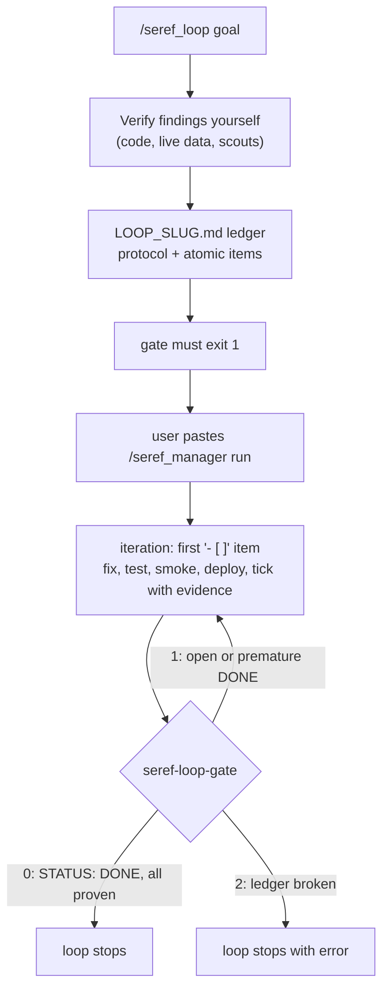

# seref_loop

A way to make omp's `/loop` run until a whole list of work is *really* finished, and to let the
agent declare it finished in a way a shell check can trust.

It came out of the bist_bot audit (2026-10-17). That audit produced 26 findings to fix, too many
for one session. The fix: a checklist file that serves as the loop's memory, plus a gate command
that `/loop --until` runs before each iteration.

## How it works



1. **Setup (`/seref_loop [goal | findings file]`)**, one turn, no fixing yet:
   - The agent checks every claim against the code and the live hosts itself, drops or
     downgrades the ones that don't hold, and adds what it finds on its own.
   - It writes `LOOP_<SLUG>.md` at the repo root from `templates/LEDGER.md`: a project-specific
     protocol (tests, smoke hosts, deploy windows, backups, commit policy) and one line per atomic
     item with file:line, evidence, fix direction and an acceptance check.
   - It runs the gate (it must exit 1) and replies with the exact command to paste, plus the
     default decisions it made, so you can veto them first.
2. **Run (`/seref_manager run LOOP_<SLUG>.md --max N`)**, driven by
   [seref_manager](../seref_manager/README.md):
   - Each iteration takes the first `- [ ]`, re-checks it, fixes it, verifies it, and marks it
     `- [x] … — DONE: <evidence>`. Wrong findings become `INVALID:`. Real blockers become
     `- [!] … — BLOCKED: <reason>`.
   - When nothing is open, the agent runs every suite and writes `STATUS: DONE`. That is how it
     claims done.
   - Between iterations the manager model reviews the transcript, reopens ticks it doesn't back
     (`— MANAGER(itN): reopened: …`), answers the worker's questions, and steers the next
     iteration. The gate alone decides done.
   - `N` caps the iterations as a backstop. Esc pauses; `/seref_manager resume` continues.
   - Without the extension, the reply's `/loop N --until '…/seref-loop-gate LOOP_<SLUG>.md' …`
     line runs the same ledger with no manager. Switching to `/seref_manager run` later (after
     turning `/loop` off) audits the ticks made without it before continuing.

## The gate (`bin/seref-loop-gate [LEDGER]`)

The gate runs after every iteration (`/seref_manager`, or `/loop --until`): exit 0 stops, 1 runs
again, anything else stops with an error.

| Ledger state | Exit | Loop |
|---|---|---|
| `- [ ]` items left | 1 | next iteration |
| `STATUS: DONE` but an item is open, a `[x]` lacks `DONE:`/`INVALID:`, or a `[!]` lacks `BLOCKED:` | 1 | next iteration (the claim is rejected) |
| `STATUS: DONE`, every item `[x]` with evidence or `[!]` with a reason | 0 | stops: done |
| No ledger, no `STATUS:` line, unknown status, no items, an unfilled `{{PLACEHOLDER}}` | 2 | stops, shows the reason |

The gate prints a one-line summary to stderr, e.g. `OPEN: 3 done, 0 blocked, 23 open of 26`.

## Files

| Path | What |
|---|---|
| `commands/seref_loop.md` | the `/seref_loop` slash command (the setup methodology the agent follows) |
| `templates/LEDGER.md` | ledger skeleton: STATUS line, per-iteration protocol, item format |
| `bin/seref-loop-gate` | the stop condition for `/loop --until` |
| `tests/test_gate.sh` | contract test for the gate's exit codes |
| `install.sh` | links the command into `~/.omp/agent/commands/` (or `$PI_CODING_AGENT_DIR/commands`) and this folder to `~/.omp/agent/seref_loop`, the toolkit path the command and the ledger template refer to |

## Install / test

```bash
./install.sh          # then restart omp (or /reload-plugins) to pick up /seref_loop
./tests/test_gate.sh
```

The command is a symlink, so edits here apply on the next omp start. It goes through omp's
Handlebars rendering, so keep `{{` out of `commands/seref_loop.md`; the template's placeholders
live in `templates/LEDGER.md`, which is copied, not rendered.

## Tips

- With the `/loop` fallback and more than ~15 items, set `loop.mode` to `compact` or `reset`. The
  ledger carries all state, so a fresh context each iteration is safe. `/seref_manager` decides
  compaction per iteration instead.
- One ledger per goal. Keep it at the repo root next to the code it fixes; delete it after the
  loop ends (the gate treats a missing ledger as an error, so not while it runs).
- **Usage limits under plain `/loop`.** omp's `/loop` does not look at how a turn ended: when the
  provider's usage limit (Claude 5-hour/weekly window, Codex limit) runs out, every iteration fails
  within seconds and `/loop` resubmits after 0.8 s. A count loop (`/loop 40 …`) burns its whole
  count without doing work, a duration loop spins until its deadline, and the gate runs each time
  (harmless: the ledger is untouched). To make plain `/loop` survive a limit, set
  `retry.waitForUsageReset: true` in `~/.omp/agent/config.yml`: when omp knows the reset time it
  then sleeps until the reset inside the turn, and `/loop` never sees a failure. When omp does not
  know the reset time it still gives up, so the count still burns. `/seref_manager` handles both
  cases and continues by itself after the reset.
