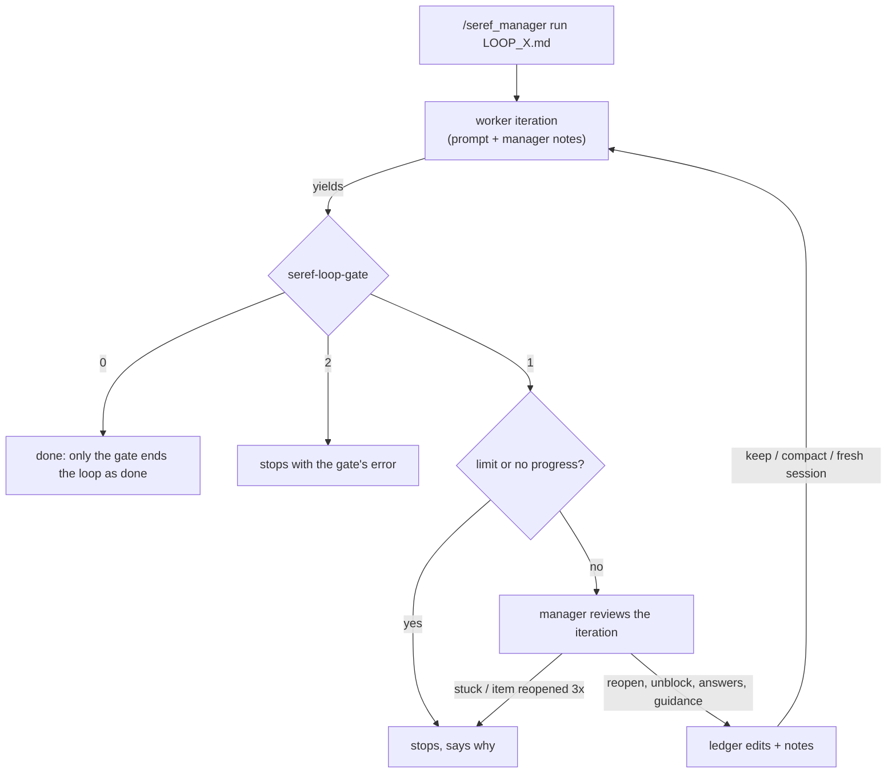

# seref_manager

An AI manager for [seref_loop](../seref_loop/README.md) ledgers. omp's `/loop` only resends the same
prompt until a shell check passes, and an `ask` dialog during an overnight run waits forever.
`/seref_manager run` drives the loop itself: after every iteration a manager model reviews what the
worker actually did and decides how the next iteration starts, and it answers `ask` dialogs that
nobody answers.

It does not use omp's `judge` role. The manager is an ordinary chat model call with its own
prompts (`extension/prompts/`), running on its own **Seref Manager** model role.

## How it works



Before the first iteration, `run` audits the ledger when it already has `[x]` or `[!]` items (see
[Taking over a ledger](#taking-over-a-ledger)).

After each worker yield:

1. **Gate.** `seref-loop-gate LOOP_X.md`: exit 2 ends the loop with the error. Exit 0 ends it as
   done, unless the final iteration changed items and the manager reopens one of them on review.
2. **Hard stops.** The iteration limit (`--max`, default twice the item count, at least 5), or 2
   iterations in a row that change no item state and no STATUS line.
3. **Review.** The manager model gets the ledger, the items that changed state, the gate summary,
   a digest of the iteration (worker text, tool calls with arguments, head and tail of every tool
   result), and its own last 8 decisions. It replies with JSON:
   - `reopen`: `[x]` items ticked this iteration whose evidence the transcript doesn't back. The
     line goes back to `- [ ]`, losing its DONE evidence, with `— MANAGER(itN): reopened: <reason>`.
   - `unblock`: `[!]` items whose reason is difficulty or size, or that only wait for a decision →
     `- [ ] … — MANAGER(itN): blocker rejected: …`; for a decision, the reason is the manager's
     choice. Kept: blockers that need a credential, an unreachable host or a manual step, or that
     an explicit prohibition in the ledger or project (a path not to touch, a hold you placed) forces.
   - `answers`: questions the worker left in its final text, always decided.
   - `guidance`: instructions for the next iteration.
   - `context`: `keep` the conversation, `compact` it, or `reset` to a fresh session (the worker
     then has only the ledger and the manager's notes). `--context` can fix this instead.
   - `verdict`: `stuck` stops the loop, only when nothing can move without a credential, a host or
     a manual step from you. There is no `done`; the manager cannot finish the loop.
4. **Next iteration.** The worker prompt (`extension/prompts/worker.md`) plus the manager's notes.

If one item is reopened 3 times, the loop stops so you can look at it. If the manager call fails
twice for one iteration, that iteration continues without guidance; 3 such iterations in a row
pause the loop.

### `ask` while the loop runs

On the first `run` in a session, the extension takes over the built-in `ask` tool, keeping its
schema, description and TUI rendering:

- No loop, or the loop is paused: it runs the native `ask` unchanged.
- Loop running: the native dialog opens and you get `--grace` seconds (default 120) to answer.
  After that the dialog closes and the manager decides for you, from the ledger, the current
  iteration's transcript, and the project's rules. It never defers and never has the worker mark
  the item blocked: its answer is your decision, also where the ledger reserves a choice for you
  or "the operator". It takes the default the ledger names, else what its rules and the project's
  conventions point to, else the most conservative option that still gets the item done. The
  ledger's prohibitions (paths not to touch, forbidden windows, no destructive commands without a
  backup) stay binding. Each decision is sent to your phone ("Decided for you: …").
- `/seref_manager away` (or `--away`) skips the dialog: the manager answers at once.

Every decision and answer is appended to `LOOP_X.manager.md` next to the ledger.

## Commands

| Command | What |
|---|---|
| `/seref_manager run [LOOP_X.md] [--max N] [--grace S] [--model SPEC[:level]] [--context manager\|keep\|compact\|reset] [--away] [--no-audit] [--force]` | start; without a path it finds the ledger itself |
| `/seref_manager pause` / `resume` | pause after the current turn / continue (re-reviews the last iteration) |
| `/seref_manager stop` | end the loop |
| `/seref_manager away [on\|off]` | toggle answering `ask` without the grace period |
| `/seref_manager status` | iteration, item counts, manager model, usage per model, recent decisions, log path |
| `/seref_manager notify [test]` | show the phone channels, stall/offline settings and today's ntfy budget / send a test |

Esc during a worker turn pauses the loop. `--context` defaults to `manager` (the manager picks
per iteration); `reset` gives every iteration a fresh session, like `loop.mode: reset`.

### Manager model

The extension adds a **Seref Manager** role to omp's model picker: `/models` → Roles → Seref
Manager, then pick a model and thinking level like for any other role. The assignment is saved in
`modelRoles.seref_manager` (global or project, per `modelRoleStorage`); the same works by hand:

```yaml
modelRoles:
  seref_manager: anthropic/claude-opus-5-5:xhigh
```

Which model a review uses, first match wins:

1. `--model SPEC[:level]` on `run`: anything omp's `--model` takes (`provider/id`, a bare id, `@role`).
2. The Seref Manager role, with its thinking level.
3. The session's model at `high`.

Before each review, ask answer and audit, the manager checks its model's quota in omp's usage
reports (what `/usage` shows). The manager never switches to another model: when every account
behind its model is out, the loop waits until the first of them resets instead of making a call
that would fail.

`auto`/`inherit` levels mean `high`; `off` disables reasoning. The role is read on every call, so
changing it in `/models` mid-loop applies from the next review; `/seref_manager status` shows the
model in use and where it came from. Cost: one manager call per iteration, plus one per `ask` it
answers.

The role is registered at runtime, not written to config.yml: uninstalling the extension removes
it from the picker. A `modelTags.seref_manager` entry of your own takes precedence.

### Taking over a ledger

`/seref_manager run` with no path uses the `LOOP_*.md` in the working directory or the git repo
root, and asks which one when there are several.

If the ledger already has `[x]` or `[!]` items, for example because you ran omp's plain `/loop`
on it, the manager audits them before the loop continues, even when that loop already finished.
No transcript of that work exists, so the audit checks the repository instead, with tools that
stay inside the repo:

- `read_file`, `search` (ripgrep) and `git` (status, diff, log, show, blame, ls-files, grep) to
  look at the code and its history.
- `run_check` to run a command exactly as the ledger writes it in backticks (an acceptance
  command, the Protocol's test command). Anything else is refused, and so are ledger commands that
  deploy, delete, write files, install, push or reach other hosts (`ssh`, `rm`, `git push`, `>`,
  `curl -X POST`, …).

Each `[x]` comes out `holds`, `reopen` (the line becomes `- [ ] … — MANAGER(audit): reopened: …`)
or `unverifiable` (needs a live host or a deploy, so it stays ticked). Each `[!]` is kept (a
credential, host or manual step, or an explicit prohibition) or unblocked, a blocker that only
waits for a decision with the manager's choice. The audit uses up to 60 tool calls and 30
minutes; its findings and every tool call go to `LOOP_X.manager.md`. When the gate still passes
afterwards there is nothing left to run; otherwise
iteration 1 starts with the audit's findings in its prompt. `--no-audit` skips it.

### omp's own `/loop`

Both loops send a prompt after every turn, so they must not run together. Extensions cannot read
omp's loop state, so seref_manager tracks it from what reaches extensions:

- `run` refuses while you have typed `/loop` (which turns it on) without turning it off again.
  If it ended by itself (a limit or its `--until` check), `--force` starts anyway.
- While seref_manager runs, typing `/loop` to turn omp's loop on is blocked.
- If omp's loop resubmits a prompt during a seref_manager run anyway, the run pauses and says so:
  type `/loop` to turn it off, then `/seref_manager resume`.

### Usage limits (quota)

When a provider's usage limit runs out (Claude's 5-hour or weekly window, a Codex limit, a spend
cap), the loop waits for the reset and then continues by itself. Short per-minute throttles are not
usage limits; omp's own retry handles those inside the turn.

1. **omp waits inside the turn when it knows the reset time.** While a loop runs, seref_manager turns
   on omp's `retry.waitForUsageReset` (runtime only, never written to config.yml, released when the
   loop ends). When omp knows the reset time from the provider or its usage report, it sleeps until
   then and the worker's turn just continues. The status line shows `usage limit, omp retries at
   HH:MM`; Esc cancels omp's wait.
2. **Otherwise seref_manager waits.** When the worker's turn, the manager's review or the audit ends
   on a usage limit, the loop does not pause or count a failure. It picks the next attempt from, in
   order: the earliest account reset in omp's usage reports for that model's provider (the same
   data as `/usage`: Claude's 5-hour and 7-day windows per account, Codex's windows, …), the
   provider's "try again in"/`retry-after` hint or omp's own estimate, else a probe 30 minutes
   out, plus one minute of margin. With several accounts for one provider, the first account to
   reset counts, since omp rotates to it. The status line shows `usage limit, resumes HH:MM`. When
   the time comes it re-checks the usage report (and waits longer if the account is still out),
   then continues what stopped: the worker gets a prompt to finish the interrupted iteration, or
   the review or audit runs again with the same manager model.
3. **The wait survives a restart.** It is saved with the loop, so resuming the session (`omp -c`)
   re-arms it instead of restoring the loop paused.

`/seref_manager resume` tries right away instead of waiting; `pause` and `stop` work as usual. An
`ask` that the manager cannot answer because of its own usage limit is not deferred: the worker
leaves the item open, ends its turn with the question, and the manager's review decides it once
its limit resets. Every wait and its source go to `LOOP_X.manager.md`.

`/seref_manager status` (and the `run` notice) lists the usage of every model the loop spends quota
on: the worker (session model), its subagents (`task` role) when that is another model, and the
manager role, e.g. `usage · manager openai-codex/gpt-6.1-sol: out of quota until Sat Oct 24 14:24`.

### Phone notifications (ntfy)

Loop events go to your phone through [ntfy](https://ntfy.sh), on two kinds of channel:

- **The general channel** (`topic` in `~/.config/seref_omp_tools/ntfy.json`) only announces new
  loops: `horus: new seref loop — horus · LOOP_X.md started on <host> (…). Subscribe to
  horus-k3j8q2wmzv for its progress.` Tapping it opens that topic. Subscribe to this one once.
- **One channel per loop** (`<project>-<10 random chars>`, made when the loop starts, kept across
  restarts) gets everything about that loop. Subscribe when the announcement arrives; unsubscribe
  when the loop is over.

```json
{ "server": "https://ntfy.sh", "topic": "seref-…", "minPriority": 2, "stallMinutes": 20, "offlineMinutes": 60 }
```

`SEREF_NTFY_TOPIC`, `SEREF_NTFY_SERVER` and `SEREF_NTFY_TOKEN` override the file, and
`SEREF_NTFY_CONFIG` points at another file. The file is read for every message, so edits apply
at once; without a topic nothing is sent. `"perLoop": false` sends everything to the general
channel instead. Messages in a loop's channel are titled `<project> · <ledger> · it N/M`.

| Event (loop channel) | Priority |
|---|---|
| Started; progress after each iteration (items ticked, what the manager reopened, counts); a wait or stall over; an `ask` the manager decided for you; audit with nothing reopened | 2 (low) |
| Done; waiting for a usage limit until HH:MM; model requests failing repeatedly (network, overload); audit reopened items; back online after ntfy was unreachable | 3 (default) |
| Stuck or iteration limit; paused by an error; an item stays `[!]` blocked after the review (credential, host, manual step); a stall; no sign of life | 4 (high) |
| Gate error (broken ledger) | 5 (urgent) |

**Stalls**, each reported once, then once more when it ends (`stallMinutes`, default 20):

- *worker*: a turn runs but no tokens, tool output or turn boundary came for that long (a long
  silent command, or a hang). Not while omp itself sleeps through a usage limit.
- *manager*: a review or `ask` answer runs longer than that (the audit: plus its 30 minutes).
- *loop*: the loop is on but nothing runs; it is also nudged once.

**No sign of life** is a dead man's switch kept on the ntfy server: while the loop is on (also
during usage-limit waits), omp keeps pushing a scheduled message `offlineMinutes` into the future
under one sequence id, at most every half of that. When omp crashes or is killed, the machine
sleeps or goes off, or its network drops, the pushes stop and the server delivers the alert by
itself. Pausing, stopping or closing omp cancels it. When ntfy was unreachable for a while and
comes back, a "back online" message follows, and messages that could not be sent meanwhile are
delivered, marked delayed.

None of this is shown in omp's chat; the chat gets only the one line with the loop's topic at
`run`. `/seref_manager notify` shows the channels, the stall and offline settings and how many of
the day's messages are left; `/seref_manager notify test` sends a test to the general channel
and the current loop's.

Budget: ntfy.sh allows 250 messages a day per IP. A loop uses about 48 a day for the offline
switch (one push per 30 minutes at the default 60) plus one per iteration and its events, so
about four long loops at once fit; `"offlineMinutes": 0` turns the switch off, a higher value
pushes less often. `minPriority: 3` drops the low-priority messages (progress included). Pauses
and stops you caused yourself (`pause`, `stop`, Esc) are not sent. ntfy.sh is public: anyone who
knows a topic can read it, and messages carry item text, so topics are random, and a self-hosted
ntfy (`server` plus `token`) removes both the exposure and the limit. A failed send is logged to
`LOOP_X.manager.md` and never affects the loop.

### Restarts and session switches

Loop state is saved in the session (custom `seref_manager_state` entries, invisible to the
model) after every change. Resuming that session (`omp -c`, `--resume`, `/resume`) restores the
loop paused, unless it was waiting out a usage limit, in which case it keeps waiting and continues
by itself. `/seref_manager resume` re-reviews the interrupted iteration and continues. Leaving the
session (`/new`, `/resume` elsewhere) detaches the loop without ending it. With `--context reset`
each iteration is its own session file, linked through `parentSession`; the newest one carries
the state.

## Install / test

```bash
./install.sh     # links extension/ to ~/.omp/agent/extensions/seref_manager; restart omp
bun test         # ledger edits (against the real gate), ledger discovery, reply parsing, transcript
                 # digest, state restore, tool safety, usage-limit detection and resume timing
```

The gate is found at `../seref_loop/bin/seref-loop-gate`, relative to this repo's real path;
set `SEREF_LOOP_GATE` to use another one.

## Limits

- During the loop the manager reviews only items that changed state in the iteration it sees;
  items ticked before it took over are covered by the audit.
- The audit cannot verify checks that need live hosts or deploys; those items are reported
  `unverifiable` and stay ticked.
- After an omp restart the loop needs one `/seref_manager resume`: starting a fresh session
  needs a command context, and only a command provides one.
