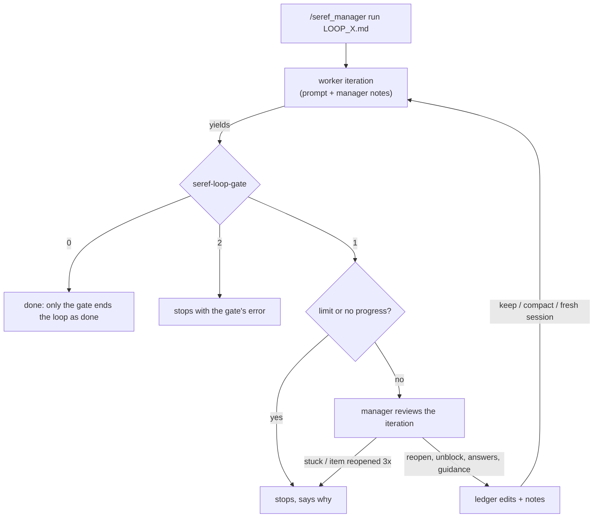

# seref_manager

An AI manager for [seref_loop](../seref_loop/README.md) ledgers. omp's `/loop` only resends the same
prompt until a shell check passes, and an `ask` dialog during an overnight run waits forever.
`/seref_manager run` drives the loop itself: after every iteration a manager model reviews what the
worker actually did and decides how the next iteration starts, and it answers `ask` dialogs that
nobody answers.

It does not use omp's `judge` role. The manager is an ordinary chat model call with its own
prompts (`extension/prompts/`), running on its own **Seref Manager** model role.

## How it works



After each worker yield:

1. **Gate.** `seref-loop-gate LOOP_X.md`: exit 2 ends the loop with the error. Exit 0 ends it as
   done, unless the final iteration changed items and the manager reopens one of them on review.
2. **Hard stops.** The iteration limit (`--max`, default twice the item count, at least 5), or 2
   iterations in a row that change no item state and no STATUS line.
3. **Review.** The manager model gets the ledger, the items that changed state, the gate summary,
   a digest of the iteration (worker text, tool calls with arguments, head and tail of every tool
   result), and its own last 8 decisions. It replies with JSON:
   - `reopen`: `[x]` items ticked this iteration whose evidence the transcript doesn't back. The
     line goes back to `- [ ]`, losing its DONE evidence, with `— MANAGER(itN): reopened: <reason>`.
   - `unblock`: `[!]` items whose reason is difficulty or size → `- [ ] … — MANAGER(itN): blocker rejected: …`.
   - `answers`: questions the worker left in its final text, answered or explicitly deferred.
   - `guidance`: instructions for the next iteration.
   - `context`: `keep` the conversation, `compact` it, or `reset` to a fresh session (the worker
     then has only the ledger and the manager's notes). `--context` can fix this instead.
   - `verdict`: `stuck` stops the loop. There is no `done`; the manager cannot finish the loop.
4. **Next iteration.** The worker prompt (`extension/prompts/worker.md`) plus the manager's notes.

If one item is reopened 3 times, the loop stops so you can look at it. If the manager call fails
twice for one iteration, that iteration continues without guidance; 3 such iterations in a row
pause the loop.

### `ask` while the loop runs

On the first `run` in a session, the extension takes over the built-in `ask` tool, keeping its
schema, description and TUI rendering:

- No loop, or the loop is paused: it runs the native `ask` unchanged.
- Loop running: the native dialog opens and you get `--grace` seconds (default 120) to answer.
  After that the dialog closes and the manager answers from the ledger, the current iteration's
  transcript, and the project's rules. It defers instead of guessing when the choice is
  destructive, touches credentials, money or live data, breaks a ledger rule, or has no
  conservative default. A deferred question tells the worker to mark the item
  `BLOCKED: awaiting user: <question>` and move on.
- `/seref_manager away` (or `--away`) skips the dialog: the manager answers at once.

Every decision and answer is appended to `LOOP_X.manager.md` next to the ledger.

## Commands

| Command | What |
|---|---|
| `/seref_manager run <LOOP_X.md> [--max N] [--grace S] [--model SPEC[:level]] [--context manager\|keep\|compact\|reset] [--away]` | start; the gate must exit 1 |
| `/seref_manager pause` / `resume` | pause after the current turn / continue (re-reviews the last iteration) |
| `/seref_manager stop` | end the loop |
| `/seref_manager away [on\|off]` | toggle answering `ask` without the grace period |
| `/seref_manager status` | iteration, item counts, manager model, recent decisions, log path |

Esc during a worker turn pauses the loop. `--context` defaults to `manager` (the manager picks
per iteration); `reset` gives every iteration a fresh session, like `loop.mode: reset`.

### Manager model

The extension adds a **Seref Manager** role to omp's model picker: `/models` → Roles → Seref
Manager, then pick a model and thinking level like for any other role. The assignment is saved in
`modelRoles.seref_manager` (global or project, per `modelRoleStorage`); the same works by hand:

```yaml
modelRoles:
  seref_manager: anthropic/claude-opus-5-5:xhigh
```

Which model a review uses, first match wins:

1. `--model SPEC[:level]` on `run`: anything omp's `--model` takes (`provider/id`, a bare id, `@role`).
2. The Seref Manager role, with its thinking level.
3. The session's model at `high`.

`auto`/`inherit` levels mean `high`; `off` disables reasoning. The role is read on every call, so
changing it in `/models` mid-loop applies from the next review; `/seref_manager status` shows the
model in use and where it came from. Cost: one manager call per iteration, plus one per `ask` it
answers.

The role is registered at runtime, not written to config.yml: uninstalling the extension removes
it from the picker. A `modelTags.seref_manager` entry of your own takes precedence.

### Restarts and session switches

Loop state is saved in the session (custom `seref_manager_state` entries, invisible to the
model) after every change. Resuming that session (`omp -c`, `--resume`, `/resume`) restores the
loop paused; `/seref_manager resume` re-reviews the interrupted iteration and continues. Leaving
the session (`/new`, `/resume` elsewhere) detaches the loop without ending it. With
`--context reset` each iteration is its own session file, linked through `parentSession`; the
newest one carries the state.

## Install / test

```bash
./install.sh     # links extension/ to ~/.omp/agent/extensions/seref_manager; restart omp
bun test         # ledger edits (against the real gate), reply parsing, transcript digest, state restore
```

The gate is found at `../seref_loop/bin/seref-loop-gate`, relative to this repo's real path;
set `SEREF_LOOP_GATE` to use another one.

## Limits

- The manager reviews only items that changed state in the iteration it sees. An unproven tick
  from an earlier run is not re-checked.
- After an omp restart the loop needs one `/seref_manager resume`: starting a fresh session
  needs a command context, and only a command provides one.
